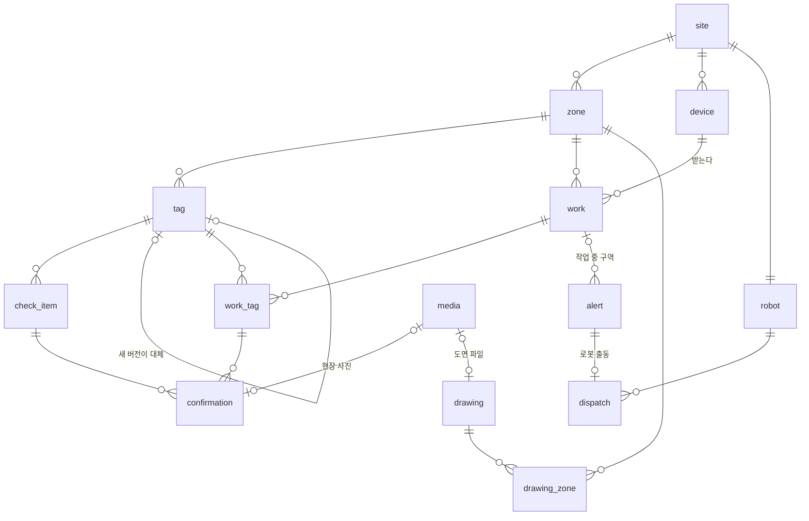
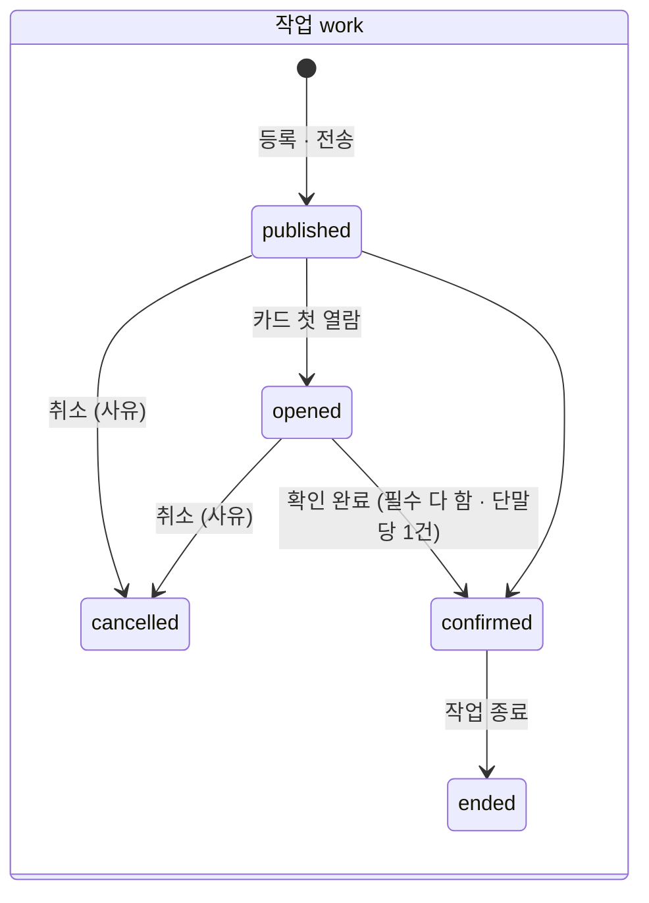

# ERD (데이터 설계)

> v5 · 2026-10-12 · **원본은 DDL** [`backend/db/migrations/0000_init.sql`](../backend/db/migrations/0000_init.sql) — 이 문서는 읽기용 요약
> v1~v4 의 설계 근거(비콘 · 실시간 위치 확장 등)는 기획 폴더의 `02_ERD_데이터설계.md`. v5 = 프론트 계약(SPEC v2 §8) 반영
> v5.1 · 2026-10-18 · [`0001_beacon.sql`](../backend/db/migrations/0001_beacon.sql) 비콘 구역 (⚠️ 잠정 — 팀 합의 전, 맨 아래)

## 원칙

1. **화면만 믿지 않고 DB 에서도 막는다** — 값 · 사진 없는 확인, 범위 밖 측정값, 중복 확인, 작업에 없는 항목, 한 단말 작업 중 둘 …
2. **기록은 고치거나 지우지 않는다** — 확인(`confirmation`) · 이벤트(`event`) · 작업에 묶인 태그(`work_tag`)는 UPDATE · DELETE · TRUNCATE 를 트리거가 막는다
3. **태그는 고치지 않고 새 버전을 만든다** — 이미 보낸 작업은 예전 버전을 계속 가리킨다 (무엇을 보고 확인했는지 남는다)
4. **위치 이력은 남기지 않는다** — `zone.changed` 같은 이벤트 종류가 없다. 비콘 구역(v5.1)도 서버 메모리에서만 판정하고,
   쓰러짐 알림이 난 순간의 구역만 `alert.zone_source` 와 함께 남는다. 사람 위치 추적(이력)은 로드맵
5. **상태 변경 + 이벤트 = 한 트랜잭션** — 이력 화면은 `event` 를 그대로 보여준다
6. **모든 주요 테이블에 `site_id`** — 데모는 현장 1개, 여러 현장 대비

## 테이블

| 테이블 | 무엇 | 핵심 컬럼 · 규칙 |
|---|---|---|
| `site` | 현장 | |
| `scan` | 3D 스캔 = 좌표계 | 현장당 활성 1개 (부분 유일 인덱스) |
| `zone` | 구역 | `polygon` 바닥 다각형 (지금은 화면 사각형 4점 → API `rect`) · ⚠️ 3D 연동 때 재결정 |
| `device` | 작업자 단말 (`device-01` = 작업반장 휴대폰) | 로그인 없음 → 단말로 작업을 받는다 · `beacon_id` = 헬멧 비콘 iBeacon `uuid:major:minor` (v5.1, 유일 · 형식 검사) |
| `robot` | 순찰 로봇 | `mode` ready · charging · maintenance · offline, `battery`, 대기 위치 · 현재 자세 |
| `media` | 파일 (사진 · 허가서 · 도면) | `sha256` (증빙: 바뀌지 않았음), 파일은 `FILES_DIR/<회차>/` |
| `tag` | 위험 태그 | `version` · `supersedes_tag_id`(API `replacesId`) · `superseded_at` · `emergency_note` · `official`(승인은 한 번) · 바닥 `x, y` (`z` 는 3D 연동 후) |
| `check_item` | 작업 전 확인 항목 | `needs` none · value · photo, `required`, 정상 범위 `range_min` · `range_max` · `range_max_exclusive`(미만) |
| `work` | 작업 (작업 등록) | `zone_id` · `device_id` · 상태 5개 · 단계별 시각(`opened_at` · `checked_in_at` · `confirmed_at` · `ended_at` · `cancelled_at`) · 허가 시간 · 허가서 |
| `work_tag` | 작업 ↔ 태그 (보낸 순간의 버전) | 추가만 |
| `confirmation` | 작업반장의 확인 | 추가만. (작업, 항목)당 1번. 사진은 파일(`photo_media_id`) 또는 이름(`photo_name`, 임시) |
| `alert` | 쓰러짐 · 측정 이상 | `type` fall · abnormal, `source` sos_button · accel · operator · debug · reading, 상태 5개, `robot_unavailable` · `human_dispatched_at` · `acknowledged_at` · `resolution`, 측정 이상이면 항목 · 값 · 재측정값 · `zone_source` request · beacon · work (v5.1) |
| `dispatch` | 로봇 출동 (알림당 1번) | `computed` live · precomputed, 경로 · 궤적, 상태 planning · moving · arrived · failed · cancelled |
| `drawing` · `drawing_zone` | 도면 · 관련 구역 | 파일(`media_id`) 또는 프론트 정적 주소(`url`) 중 하나, 관련 설비 번호 `equipment[]` |
| `event` | 기록 (이력 화면) | 23종 · `text`(화면에 보일 한 줄) · 무엇에 대한 기록인지(tag · work · alert · dispatch · drawing · device) |
| `anchor` · `rssi_fingerprint` | 고정 비콘 · 수신기(`kind = 'gateway'`, v5.1) · 스캔 중 RSSI | 수신기는 씬 `gateways` 에서 들어온다 (MAC 없이 id 로 찾는다, 고정 비콘은 MAC 필수). `rssi_fingerprint` 는 로드맵 |

## 상태

| 알림 | 흐름 |
|---|---|
| 쓰러짐 (fall) | `dispatched`(로봇 출발) → `arrived` → `resolved` · 로봇이 못 가면 처음부터 `no_robot`(충전 · 점검 · 연결 끊김 · 다른 출동 · 구역 불명 · 경로 없음) · 가다가 막히면 `no_robot`(도달 실패) · 어느 상태에서든 `resolved`(처리 완료 · 오탐 해제) |
| 측정 이상 (abnormal) | `open` → `resolved` (로봇 출동 없음). 같은 항목에 이상값이 다시 오면 값만 바뀌고, 정상값이 확인되면 재측정값이 붙는다 |
| 관제 확인 · 사람 출동 | 상태를 바꾸지 않는 기록 (`acknowledged_at` · `human_dispatched_at`) |

## 회차 (데모 리셋)

리셋해도 기록을 지우지 않기 위해 **데모 한 회차 = PostgreSQL 스키마 하나** (`gx_20261105_142101`).
리셋 → 새 스키마에 DDL + 설정 + 데모 데이터(`backend/scenes/dev/demo/seed.json`) → 그쪽으로 전환. 지난 회차는 자기 스키마에 그대로 남는다.
회차 목록은 `public.gx_session`, 서버는 가장 최근 회차로 켜진다. 백업은 `pg_dump` 한 번이면 모든 회차가 담긴다.

## DB 가 막는 쓰기 (테스트로 고정: `backend/test/db-rules.test.ts`)

값 없는 측정 항목 · 범위 밖 값(경계 포함: 산소 23.5% 미만) · 사진 없는 사진 항목 · 작업에 없는 태그 · 다른 태그의 항목 · 같은 항목 두 번 ·
확인 · 이벤트 · 작업 태그 수정/삭제/TRUNCATE · 태그 내용 수정 · 예전 버전 되살리기 · 승인 되돌리기 · 승인 없이 확인 정보만 채우기 · 활성 스캔 둘 ·
`zone.changed` · 깨진 JSON · 알림당 출동 둘 · 등록 안 된 단말 · 한 단말 작업 중 둘 · 시작한 작업 취소 · 사유 없는 취소 · 시작 전 종료 ·
종료 시각 없는 종료 · 측정값 없는 측정 이상 · 쓰러짐을 측정값 출처로 · 결과 없는 알림 종료 · 이유 없는 '사람 출동 필요' · 파일도 주소도 없는 도면 ·
없는 구역의 도면 · MAC 도 비콘 id 도 없는 헬멧 비콘 · 비콘 id 형식 · 두 단말이 같은 비콘 id · MAC 없는 고정 비콘 · 모르는 구역 출처(v5.1) — 39가지. 통과해야 하는 것(경계값 18%, 승인 한 번, 모든 컬럼을 그대로 실은 UPDATE …)도 함께 고정

## v4 → v5 (10/12, 프론트 SPEC v2 §8)

| | v4 | v5 |
|---|---|---|
| 현장 | `space` | `site` + 주요 테이블에 `site_id` |
| 단말 | `helmet-01` | `device-01` (작업반장 휴대폰) |
| 작업 | 상태 4개, 구역 없음 | `zone_id` · `cancelled` · 단계별 시각 · 허가 시간(`permit_start` · `permit_end`) · 허가서 이름 · 단말당 작업 중 1건 |
| 확인 항목 | `needs` | + `required` · 정상 범위(이상 / 이하 · 미만) |
| 태그 | 대체 사슬만 | + `version` · `superseded_at` · `zone_id` · `emergency_note`, 승인은 한 번 (트리거) |
| 알림 | fall · sos, 출처 device · sim · manual | `type` fall · abnormal, 출처 5가지(10/10 결정), `no_robot` · 사람 출동 · 결과(처리 완료 · 오탐 해제) · 측정 이상 값 |
| 출동 | 4개 상태 | + `cancelled` |
| 도면 | — | `drawing` · `drawing_zone` |
| 이벤트 | 15종, payload | 23종 + `text` |
| 리셋 | 열린 알림 해제 · 로봇 복귀 | 새 회차(스키마) |

## v5 → v5.1 (10/18, 비콘 구역 · ⚠️ 잠정)

| | v5 | v5.1 (`0001_beacon.sql`) |
|---|---|---|
| 단말 | `mac` (폰이 아니면 필수) | + `beacon_id` (iBeacon `uuid:major:minor`, 유일). 폰은 광고할 때 MAC 이 수시로 바뀌어 MAC 으로 못 찾는다. 규칙: 폰이 아니면 MAC 이나 비콘 id 중 하나 |
| 앵커 | `mac` 필수 | 수신기(`gateway`)는 MAC 없이 (보고에 실린 id 로 찾는다) |
| 알림 | `zone_id` | + `zone_source` — 구역을 어디서 정했나 (직접 지정 · 비콘 · 작업 중 구역). 이 판 이전 알림은 NULL |
| 위치 | — | 구역 판정 · 레이더 위치(수신기 두 대, 10/20)는 서버 메모리 (`backend/src/locate/`). 위치 테이블 · 이벤트를 만들지 않는다 |
| 수신기 설정 | 씬 파일만 | 관리자 화면 '수신기 배치'(10/22)에서 바꾼 자리 · 구역 · 1m 세기는 `.data/gateways.json` (DB 밖 — 회차와 상관없는 설치 정보). 회차마다 `anchor` 에 그 값으로 쓴다 |
